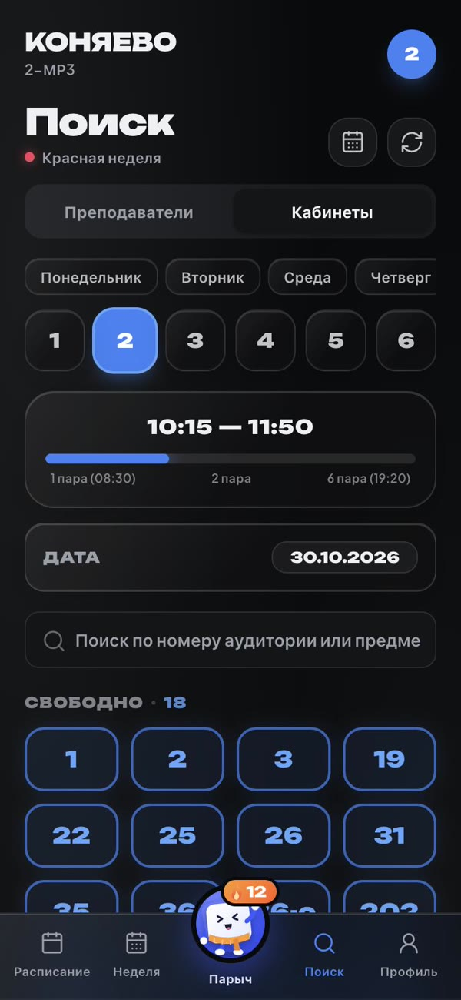

<div align="center">


# Коняево

**Расписание Тверского колледжа им. А. Н. Коняева в Telegram — с маскотом Парычем**

[Открыть бота](https://t.me/konyaevo_tver_helper_bot) · [Mini App](https://ix1ax.github.io/konyaevo-tver-helper-bot/) · [Документация для разработки](docs/DEVELOPMENT.md)


</div>

---

Коняево показывает пары на сегодня, завтра и неделю, замены, свободные кабинеты и расписание
любого преподавателя. Данные берутся прямо из таблиц колледжа и обновляются сами. Пользоваться
можно двумя способами: в чате с ботом — кнопками, или в Mini App — полноценном приложении
внутри Telegram.

В приложении живёт **Парыч**. Он подсказывает, через сколько пара и в каком она кабинете,
ведёт **огонёк** учебных дней и открывает новые облики за опыт.

## В цифрах

| | |
|---|---|
| 👥 **~880** | пользователей бота |
| 📅 **~270** | человек открывают расписание каждый день |
| 📈 **~700** | активных за месяц — почти 80% всех пользователей |
| 🔥 **100+** | зажгли огонёк в первый же день |
| 🏫 **57 групп · 78 преподавателей** | все курсы колледжа |

<sub>Данные из админ-панели бота, октябрь 2026.</sub>

## Скриншоты

<table>
  <tr>
    <td align="center"><br><sub><b>Сегодня</b> — подсказка Парыча и пары</sub></td>
    <td align="center"><br><sub><b>Парыч</b> — огонёк, уровень, задания</sub></td>
    <td align="center"><br><sub><b>Облики</b> за уровни и поддержку</sub></td>
    <td align="center"><br><sub><b>Кабинеты</b> — свободные на любую пару</sub></td>
  </tr>
</table>

## Возможности

**📅 Расписание**
- Сегодня, завтра и вся неделя: замены и отмены уже учтены, текущая пара подсвечена.
- Сводка дня: когда начнёшь, когда закончишь, сколько пар. Цвет недели определяется сам.
- Расписание любого преподавателя и свободные кабинеты на любую пару.
- Картинка с расписанием: отправить в чат группы или сохранить.

**🔔 Уведомления**
- Замены и расписание на завтра в выбранное время и в выбранные дни.
- Настройки общие для бота и приложения.

**🔥 Парыч и огонёк**
- Подсказки: «через 12 минут — химия в каб. 406. Успеваешь?», «пары закончились, загляни во «Завтра»».
- Огонёк растёт за каждый учебный день с расписанием. Выходные и каникулы его не гасят, а заморозка спасёт пропущенный день.
- Задания на день, опыт, 10 уровней и облики: осень, зима, весна, лето, выпускник.
- Напоминание в 21:00 — только если огонёк вот-вот погаснет.

**⭐ Поддержка**
- Проект бесплатный и без рекламы. Поддержать Парыча можно звёздами Telegram, без карты.
- За поддержку — особые облики: «Звёздный» и «Корона».

**🛡 Надёжность**
- Если сервер недоступен из сети пользователя, приложение показывает сохранённую копию расписания.
- У бота два независимых пути до Telegram: если один ломается, работает второй.

## Как устроено

```
Таблицы колледжа ──► бэкенд (Java, Spring Boot) ──► Telegram-бот
                                 │
                                 └─► REST API ──► Mini App (React, GitHub Pages)
```

- **Бэкенд**: Java 17, Spring Boot 3, H2, Apache POI, Telegram Bot API.
- **Mini App**: React 18, TypeScript, Vite, Tailwind CSS, Telegram WebApp SDK.
- **Инфраструктура**: Linux + systemd + nginx, GitHub Pages, Cloudflare Worker.

Как запустить у себя, настроить сервер, переменные окружения, API и история версий —
в [документации для разработки](docs/DEVELOPMENT.md).

## Автор

Илья Самсонов — [@konyaevo_tver_helper_bot](https://t.me/konyaevo_tver_helper_bot).
Идеи и ошибки — в отзывах в приложении или в чате бота.

## Лицензия

[MIT](LICENSE)
